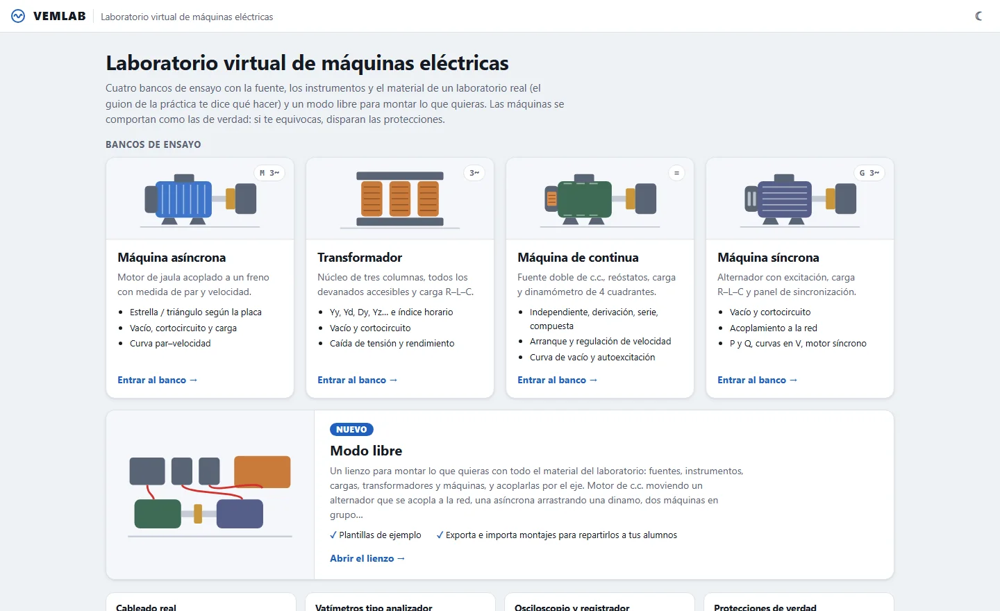
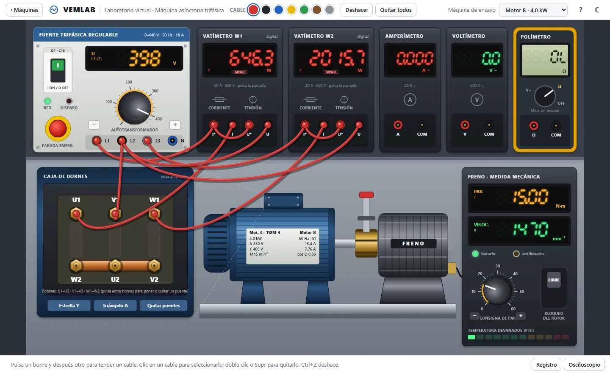
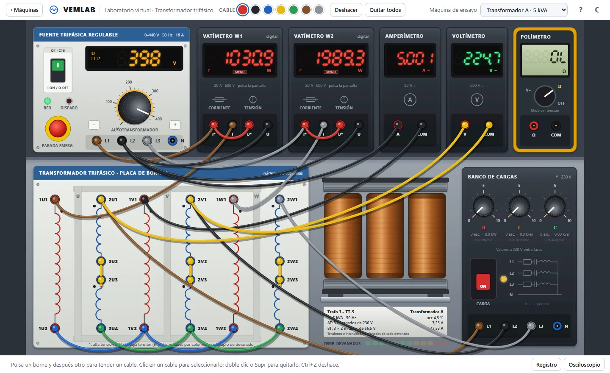
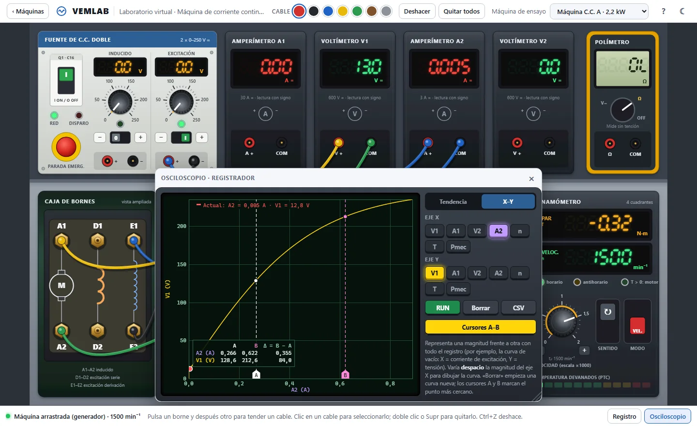
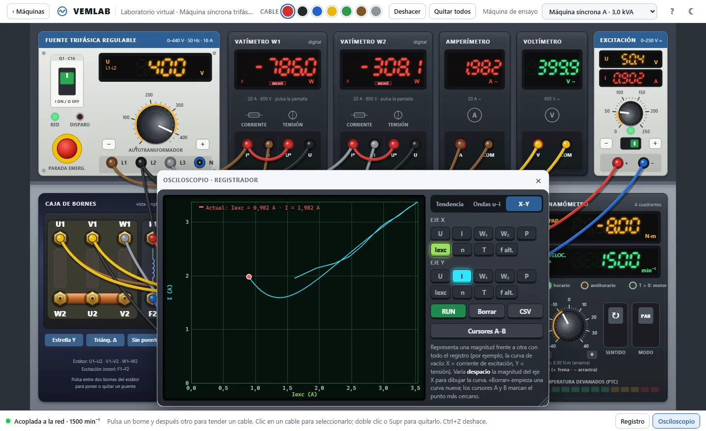
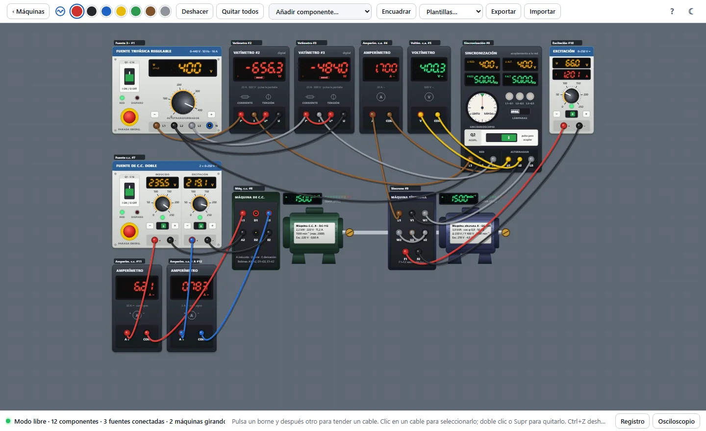
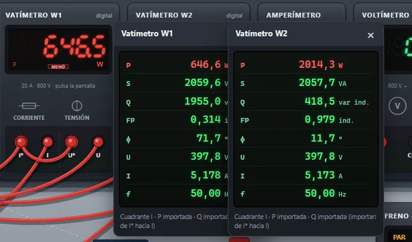

<div align="center">

# ⚡ VEMLAB

### Laboratorio virtual de máquinas eléctricas

Bancos de ensayo que se cablean y se manejan como los de un laboratorio real,<br>
con simulación física de las máquinas, protecciones que disparan e instrumentos de verdad.

**[▶ Abrir el laboratorio](https://alejandrovidalbralo.github.io/vemlab/)** &nbsp;·&nbsp;
[Cómo funciona](#-cómo-funciona-la-simulación) &nbsp;·&nbsp;
[Licencia](#-licencia)




</div>

---

## ¿Qué es?

VEMLAB es un laboratorio virtual pensado para clases de máquinas eléctricas. No hay
asistentes ni respuestas automáticas: el alumno tiene delante **la fuente, los
instrumentos, los cables y la máquina**, como en el laboratorio.
Si se equivoca, pasa lo mismo que en el laboratorio: salta el magnetotérmico, actúan
las sondas térmicas, la máquina se embala o los aparatos marcan lecturas absurdas.

- Se usa desde el navegador, **sin instalar nada**, con ratón o en **tablet**.
- Todo cabe **en una pantalla**: el banco completo, como si estuvieras delante.
- Cada banco **guarda el montaje** en el navegador para continuar otro día.

## 🔧 Bancos de ensayo

| | |
|:---:|:---|
|  | **Máquina asíncrona trifásica**<br>Motor de jaula con caja de bornes y puentes, acoplado a un freno con medida de par y velocidad.<br>· Conexión estrella / triángulo según la placa<br>· Ensayos de vacío, cortocircuito (rotor bloqueado) y carga<br>· Curva par–velocidad por el método de aceleración |
|  | **Transformador trifásico**<br>Núcleo de tres columnas con todos los extremos de devanado accesibles (BT partida en dos mitades) y banco de cargas R–L–C.<br>· Conexiones Yy, Yd, Dy, Dd, Yz, Dz e índice horario<br>· Ensayos de vacío y cortocircuito<br>· Caída de tensión y rendimiento en carga |
|  | **Máquina de corriente continua**<br>Inducido, devanado serie y derivación accesibles; fuente doble de c.c., reóstatos de arranque y de campo, carga resistiva y dinamómetro de cuatro cuadrantes.<br>· Excitación independiente, derivación, serie y compuesta<br>· Arranque, regulación de velocidad, motor serie<br>· Generador: curva de vacío, autoexcitación, característica externa |
|  | **Máquina síncrona trifásica**<br>Alternador movido por el dinamómetro, con fuente de excitación, carga R–L–C y panel de sincronización (doble voltímetro, doble frecuencímetro, sincronoscopio, lámparas e interruptor de acoplamiento).<br>· Ensayos de vacío y cortocircuito<br>· Acoplamiento a la red<br>· Potencia activa y reactiva, curvas en V, motor síncrono |

## 🧩 Modo libre



Un lienzo para montar **lo que quieras** con todo el material del laboratorio:
fuentes, instrumentos, cargas, transformadores, máquinas, dinamómetros y
**aparamenta de maniobra y protección** (contactores, relés térmicos,
magnetotérmicos, temporizadores, pulsadores, setas de emergencia y pilotos), y
**acoplar máquinas por el eje**. Por ejemplo:

- un motor de c.c. que mueve un alternador que se sincroniza con la red;
- un motor asíncrono que arrastra una dinamo con carga;
- dos máquinas asíncronas acopladas, una como motor y otra como generador;
- un transformador que alimenta una carga o un motor;
- un arranque directo con autoenclavamiento o un estrella-triángulo automático con
  contactores y temporizador.

Incluye plantillas de ejemplo y permite **exportar e importar montajes** (`.json`):
un docente prepara la práctica y la reparte a sus alumnos.

## 📟 Instrumentos



- **Vatímetros digitales** con bornes de polaridad. Al pulsar su pantalla se abre
  una ventana tipo analizador: P, S, Q, factor de potencia, φ, U, I, f y
  cuadrante (convenio IEC, inductivo / capacitivo).
- **Amperímetros y voltímetros** de alterna y de continua (estos, con signo).
- **Polímetro** en modo óhmetro (solo mide sin tensión).
- **Osciloscopio / registrador** en ventana flotante: tendencia, ondas u–i, curva
  par–velocidad y modo **X–Y** libre (curva de vacío, curva en V…), con cursores
  A–B y exportación a CSV.
- **Dinamómetro de cuatro cuadrantes**: frena o arrastra la máquina, con consigna
  de par o de velocidad.

<br clear="right">

## 🧮 Cómo funciona la simulación

- **Análisis nodal** del montaje que hace el alumno: cada cable une bornes, y la red
  completa (fuentes, instrumentos, cargas y máquinas) se resuelve en cada paso, sea
  cual sea la conexión.
- **Máquina asíncrona**: circuito equivalente por bobina resuelto por componentes
  simétricas (directa, inversa y homopolar), con saturación; funciona también con
  falta de fase, secuencia invertida o conexiones erróneas.
- **Transformador**: modelo de varios devanados por columna con saturación y la
  impedancia homopolar baja propia del núcleo de tres columnas.
- **Máquina de continua**: devanados R–L integrados en el tiempo, f.e.m. con curva de
  magnetización saturada y magnetismo remanente (el generador solo ceba con la
  polaridad y el sentido de giro correctos) y reacción de inducido.
- **Máquina síncrona**: rotor liso con curva de vacío saturada y amortiguador. La red
  y el alternador se resuelven a sus frecuencias y se combinan con su desfase
  relativo: así aparecen las pulsaciones de las lámparas, el sincronoscopio, el par
  sincronizante y el golpe al acoplar fuera de fase.
- **Modo libre**: el montaje se divide en islas eléctricas y se resuelve por
  superposición (c.c., red y cada alternador); las máquinas acopladas comparten eje.
- **Protecciones**: magnetotérmico de las fuentes, sondas PTC de los devanados,
  sobrevelocidad y pérdida de sincronismo.

Todo es **JavaScript sin dependencias ni compilación**: basta con servir la carpeta
como web estática (o abrir `index.html`).

```
index.html          portada y estructura de la aplicación
css/main.css        estilos (tema claro / oscuro)
js/model.js         números complejos, resolución de sistemas, máquina asíncrona
js/circuit.js       análisis nodal e instrumentación común
js/sim.js           simulación del banco de la asíncrona
js/trafo.js         transformador trifásico
js/dc.js            máquina de corriente continua
js/sync.js          máquina síncrona
js/mech.js          dinamómetro de 4 cuadrantes y eje
js/free.js          motor de cálculo del modo libre
js/bench*.js        bancos gráficos (SVG) de cada máquina
js/free-ui.js       lienzo del modo libre
js/scope.js         osciloscopio / registrador
js/widgets.js       displays de 7 segmentos, mandos y pulsadores
js/app.js           aplicación: estado, bucle de simulación, ventanas
docs/img/           capturas
```

## 📜 Licencia

© Alejandro Vidal Bralo. VEMLAB se distribuye con licencia
[Creative Commons Reconocimiento-NoComercial-CompartirIgual 4.0 Internacional (CC BY-NC-SA 4.0)](https://creativecommons.org/licenses/by-nc-sa/4.0/deed.es).

Puedes usarlo, copiarlo y adaptarlo libremente **en docencia y con fines no
comerciales**, citando la autoría y compartiendo las modificaciones con la misma
licencia. El texto legal completo está en [`LICENSE`](LICENSE).
